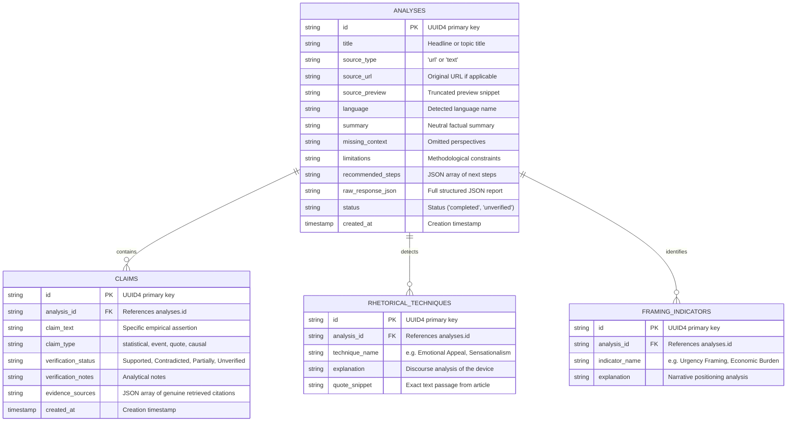

# TruthLens Database Documentation

## 1. Overview & Storage Strategy
TruthLens employs an embedded **SQLite3** relational database located at `storage/truthlens.db`.

### Design Principles:
1. **Zero External Server Dependency:** SQLite requires no external database daemons (like MySQL or PostgreSQL), eliminating port conflicts and setup hurdles during student evaluations.
2. **ACID Transactional Guarantees:** Multi-table inserts (analysis report + claims + techniques + framing) are committed inside a single atomic transaction.
3. **Relational Integrity:** Foreign key enforcement (`PRAGMA foreign_keys = ON;`) ensures that child records are automatically purged when a parent analysis is deleted (`ON DELETE CASCADE`).
4. **Data Privacy & Ephemeral Retention:** Complete, raw article text is never stored permanently. Only a 300-character preview and the structured analytical breakdown are retained. API keys are never stored in the database.

---

## 2. Entity-Relationship (ER) Diagram



---

## 3. Table Schema Specifications

### 3.1. `analyses` Table
Stores high-level metadata, the neutral summary, and overall analytical framing for an evaluated news story.

| Column | Type | Constraints | Description |
| :--- | :--- | :--- | :--- |
| `id` | TEXT | PRIMARY KEY | Unique UUID identifier (v4) |
| `title` | TEXT | NOT NULL | Headline or brief topic identifier |
| `source_type` | TEXT | CHECK IN ('url', 'text') | Origin format of the story |
| `source_url` | TEXT | NULLABLE | Original website URL (if provided) |
| `source_preview`| TEXT | NULLABLE | Truncated first 300 characters of text |
| `language` | TEXT | NOT NULL | Language name (English, Hindi, Telugu) |
| `summary` | TEXT | NULLABLE | 2-3 sentences of objective narrative summary |
| `missing_context` | TEXT | NULLABLE | Key counter-perspectives or omitted data |
| `limitations` | TEXT | NULLABLE | Caveats regarding automated evaluation |
| `recommended_steps` | TEXT | NULLABLE | JSON array of critical verification actions |
| `raw_response_json`| TEXT | NULLABLE | Full JSON representation of the report |
| `status` | TEXT | DEFAULT 'completed' | Operational state of analysis |
| `created_at` | TIMESTAMP | DEFAULT CURRENT_TIMESTAMP | Date and time record was generated |

### 3.2. `claims` Table
Stores extracted empirical statements that can be verified against external knowledge bases.

| Column | Type | Constraints | Description |
| :--- | :--- | :--- | :--- |
| `id` | TEXT | PRIMARY KEY | Unique UUID identifier (v4) |
| `analysis_id` | TEXT | NOT NULL, FK -> analyses(id) | Associated parent analysis record |
| `claim_text` | TEXT | NOT NULL | The specific assertion extracted from the text |
| `claim_type` | TEXT | DEFAULT 'factual' | Categorization (`statistical`, `event`, `quote`, `causal`) |
| `verification_status`| TEXT | CHECK IN (...) | `Supported by available evidence`, `Contradicted by available evidence`, `Partially supported`, `Unverified`, `Unable to analyze` |
| `verification_notes` | TEXT | NULLABLE | Contextual evaluation notes |
| `evidence_sources` | TEXT | NULLABLE | JSON array of retrieved reference sources `[{title, url, snippet}]` |
| `created_at` | TIMESTAMP | DEFAULT CURRENT_TIMESTAMP | Timestamp |

### 3.3. `rhetorical_techniques` Table
Stores stylistic persuasive and propaganda devices detected in the news text.

| Column | Type | Constraints | Description |
| :--- | :--- | :--- | :--- |
| `id` | TEXT | PRIMARY KEY | Unique UUID identifier (v4) |
| `analysis_id` | TEXT | NOT NULL, FK -> analyses(id) | Associated parent analysis record |
| `technique_name` | TEXT | NOT NULL | Name of rhetorical pattern (e.g., *Sensationalism*) |
| `explanation` | TEXT | NULLABLE | Discourse explanation of why it influences readers |
| `quote_snippet` | TEXT | NULLABLE | Verbatim quotation from the source text |

### 3.4. `framing_indicators` Table
Stores identified editorial or ideological narrative framing.

| Column | Type | Constraints | Description |
| :--- | :--- | :--- | :--- |
| `id` | TEXT | PRIMARY KEY | Unique UUID identifier (v4) |
| `analysis_id` | TEXT | NOT NULL, FK -> analyses(id) | Associated parent analysis record |
| `indicator_name` | TEXT | NOT NULL | Name of framing perspective |
| `explanation` | TEXT | NULLABLE | Contextual narrative breakdown |

---

## 4. Database Indexing & Performance
To guarantee sub-millisecond query execution on the dashboard and history pages, the following indexes are maintained:
```sql
CREATE INDEX IF NOT EXISTS idx_analyses_created_at ON analyses(created_at DESC);
CREATE INDEX IF NOT EXISTS idx_claims_analysis_id ON claims(analysis_id);
CREATE INDEX IF NOT EXISTS idx_claims_status ON claims(verification_status);
CREATE INDEX IF NOT EXISTS idx_rhetorical_analysis_id ON rhetorical_techniques(analysis_id);
CREATE INDEX IF NOT EXISTS idx_rhetorical_name ON rhetorical_techniques(technique_name);
```

---

## 5. Security & SQL Injection Mitigation
TruthLens strictly adheres to **parameterized query binding** across all database interactions. Raw string formatting or f-strings are never utilized for SQL queries.

**Example: Search Query Defense**
```python
# Safe parameterized query
base_sql = "SELECT id, title FROM analyses WHERE title LIKE ? OR source_preview LIKE ?"
params = [f"%{search_query}%", f"%{search_query}%"]
cursor.execute(base_sql, params)
```
Even if a user submits `' OR '1'='1` or other SQL injection payloads, SQLite treats the input strictly as literal text data rather than executable SQL logic.
